# Ashen Gate

A native Linux dark-fantasy FPS built in **Godot 4.7.2 (Forward+ Vulkan)** combining classic retro-FPS movement and combat speed with modern PBR gothic architecture, volumetric fog & god-rays, SSAO/SSIL/SSR, sculpted normal-mapped 2.5D enemies, real joint/buoyancy physics set-pieces, spatial 3D audio with per-chapter synced music stems, and Half-Life-style uninterrupted first-person storytelling.


## Play

```bash
./run.sh
```

The launcher uses Godot 4.7.2 if installed, otherwise the bundled Linux runtime or a one-time download of the official Linux runtime.

Read the full development post on [breesquared.com](https://breesquared.com/posts/ashen-gate/).

## Highlights

- **Uninterrupted Diegetic Storytelling (`StoryDirector`)** — Zero cutscenes and zero camera hijacks. Characters (**Archivist Seraphina**, **Brother Torin**, and **Lord Malcor**) walk, gesture, speak in spatial 3D, and react across physical architecture, speaking tubes, murals, and acoustic echoes.
- **Physical Interconnected Chapters** — No floating level portals: cross the **Bell Causeway** through the massive bronze Keep doors into the Bell Tower, drop down the **Belfry Shaft** onto the Kiln's ash heap, or ascend the **Archive Service Stair**.
- **Tactile Combat & Elemental Alchemy** — Four distinct weapons (**Runed Cleaver-Axe**, **Briar Arbalest**, **Cinder Thurible**, **Voltaic Tuning Fork**), timed **Parry**, **Telekinetic Repulse & Grasp** (rip tower shields off Executioners or hurl explosive casks), **Frost / Burn / Thermal Shock / Voltaic** combos, breakable boss shields, fall damage, and abyss hazards.
- **Volumetric 2.5D Enemies & Bosses** — Sculpted normal-mapped sprites with view-dependent relief, ground-contact shadows, parry glints, 3D slash arcs, and distinct archetype behaviors (**Shrieker**, **Acolyte**, **Executioner**, sound-reactive **Stalker**, **Ash Sentinel**, **Lord Malcor — Bell Warden**, and **The Ladle — Crucible Colossus**).

## Act I Campaign & Screenshot Gallery

Seven years after helping forge Vaelor's resonance locks, exiled Bell-Wright **Caelen** returns to the Ashen Gate as its fractured seal inverts and drains the living city outside.

### Chapter I — The Sunken Court (`scripts/chapters/chapter_1_court.gd`)

Descend the viaduct to meet **Brother Torin** and **Archivist Seraphina** at the Gatehouse grate, unpick your master's lock to flood the **West Cistern** and ride **buoyant timber rafts** to the **Heart of Vaelor**, brave the **East Ossuary** and the sound-reactive **Bell-Bound Stalker** (Keeper Avun), raise the hydraulic **North Portcullis**, and cross the **Bell Causeway** into the Keep.

| Gatehouse Grate & Archivist Seraphina | West Cistern & Buoyant Timber Rafts |
| :---: | :---: |
| 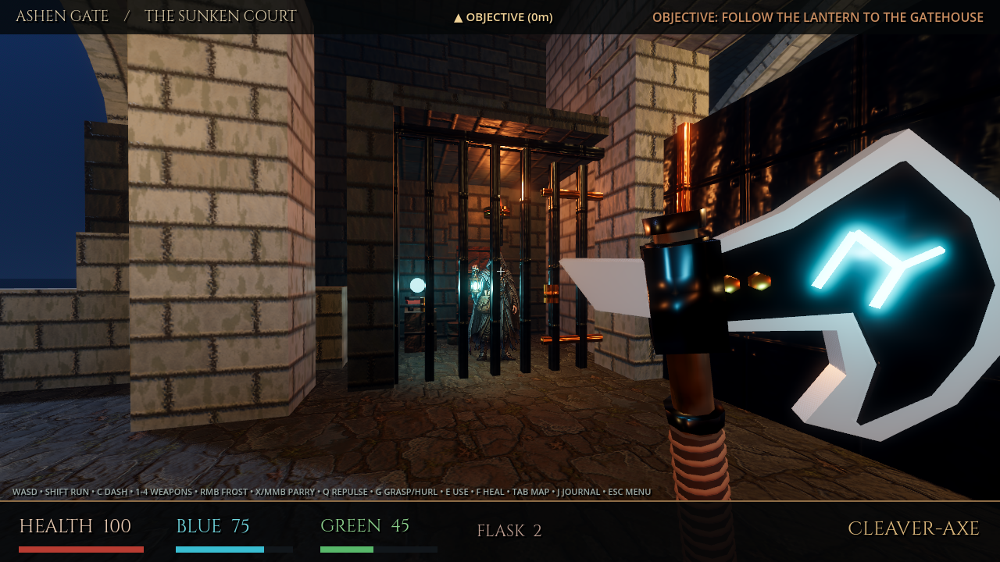 | 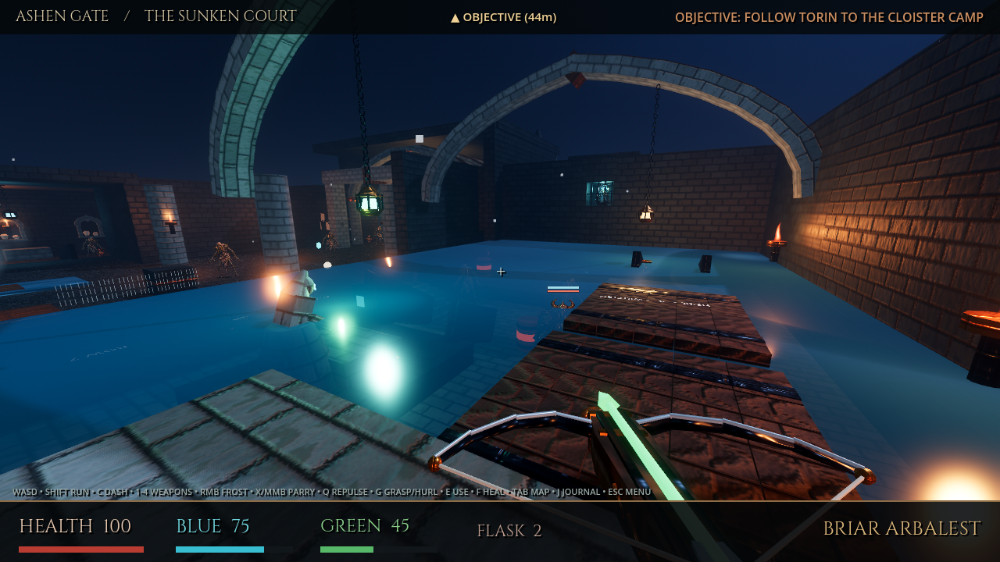 |

| East Ossuary Crypt | Court of Seals & North Portcullis |
| :---: | :---: |
| 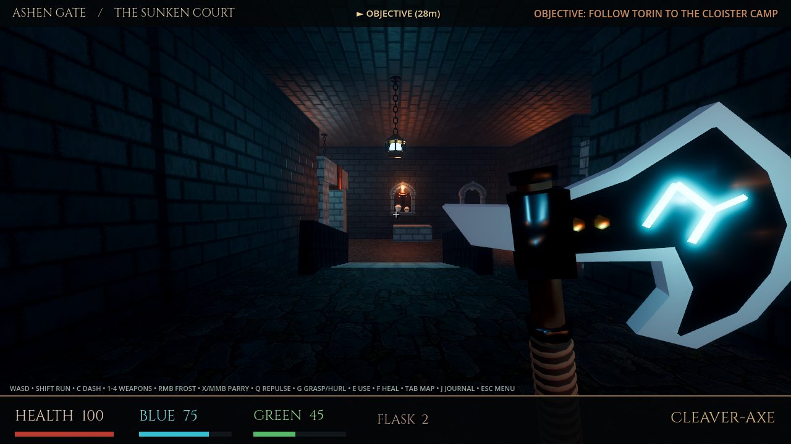 | 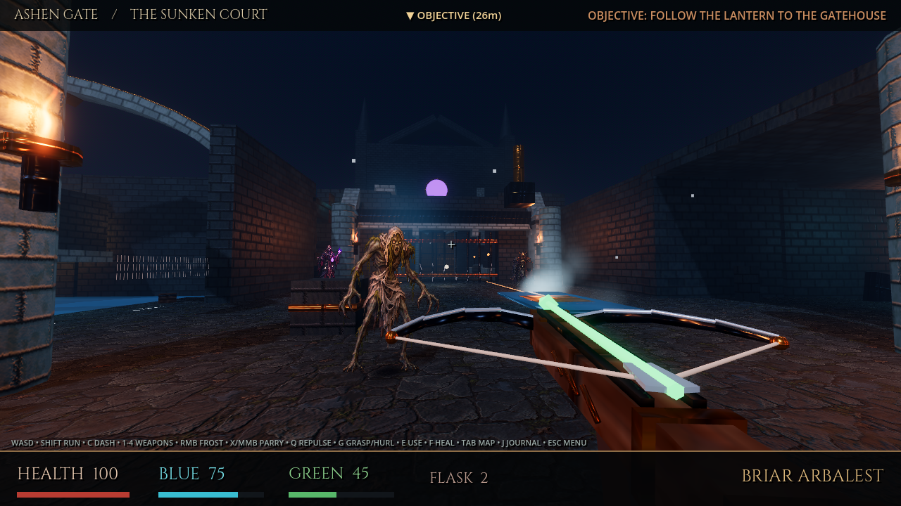 |

### Chapter II — The Bell Tower (`scripts/chapters/chapter_2_tower.gd`)

Enter the vaulted **Lower Nave**, claim the **Voltaic Tuning Fork (`4`)** in the **Clockwork Gallery**, energize and ride the **Counterweight Lift** (shooting jammed pawls mid-ascent), swing the real **`PinJoint3D` bronze clapper pendulum** in the **Pendulum Foundry** to claim the **Cinder Thurible (`3`)**, ring the **Harmonic Chimes** in the **Choir Loft**, and shatter **Lord Malcor's Resonant Aegis** beneath the open sky of the **Belfry Sanctum**.

| Lower Nave & Stained-Glass God-Rays | Pendulum Foundry (`PinJoint3D` Clapper) |
| :---: | :---: |
| 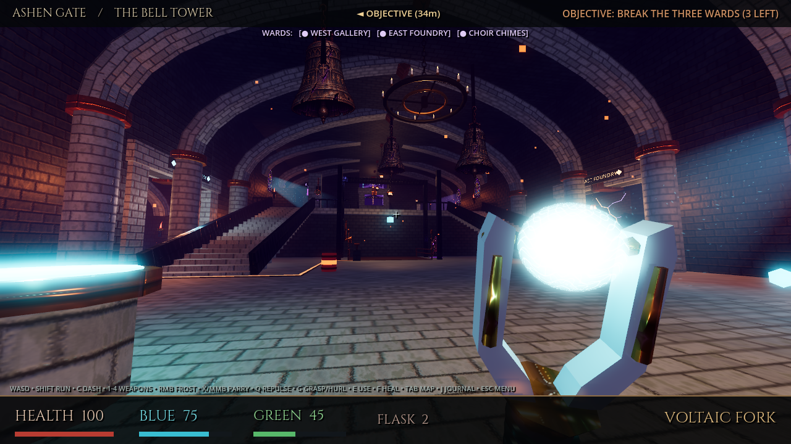 | 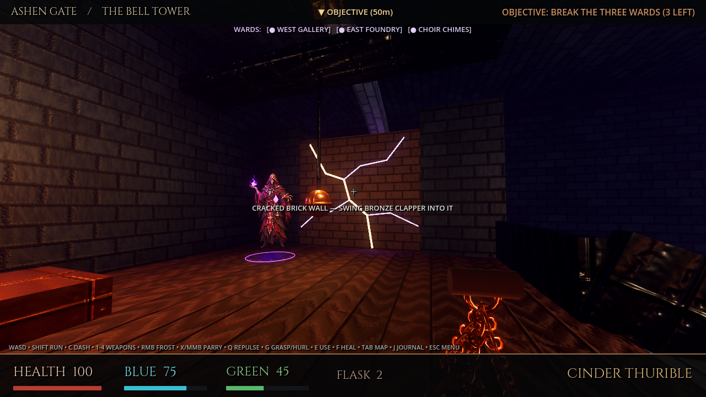 |

| Choir Loft & Harmonic Chimes | Open-Sky Belfry Sanctum — Lord Malcor |
| :---: | :---: |
| 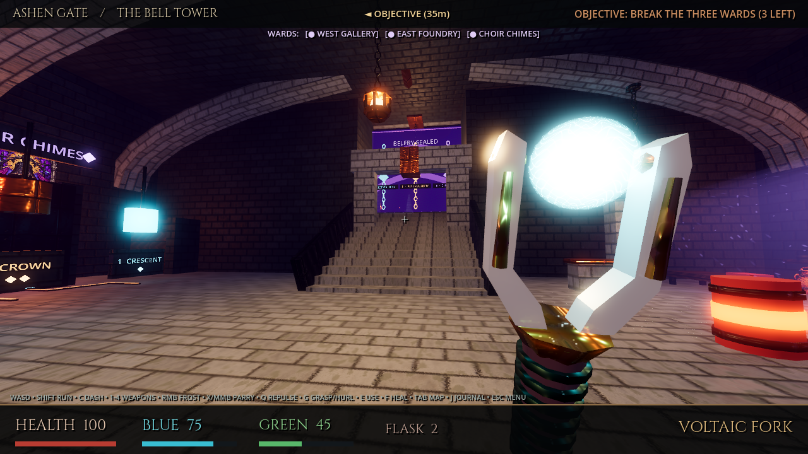 | 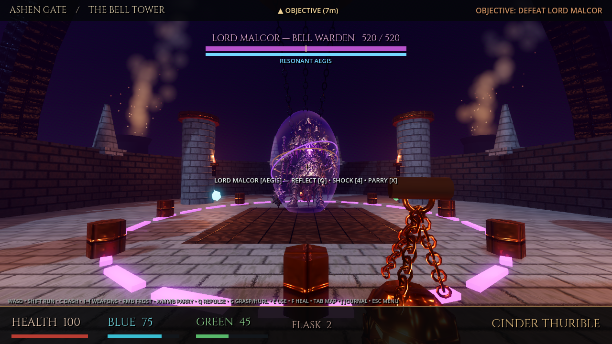 |

### Chapter III — The Kiln of Ash (`scripts/chapters/chapter_3_kiln.gd`)

Land on the **Foundry Rim** overlooking the embedded Great Bell and glowing **Name-Vessel** racks, power the **Frozen Aqueduct** pump and freeze cascading water spouts into ice stepping stones, ram the **Deep Smeltery** slag dam with the ore cart, temper the **Ashen Key**, survive the rising-slag showdown against **The Ladle — Crucible Colossus**, and unseal the **Great Ashen Gate** onto **The Hollow Beyond**.

| Foundry Rim & Archivist Seraphina | Crucible Hall — The Ladle (Crucible Colossus) |
| :---: | :---: |
| 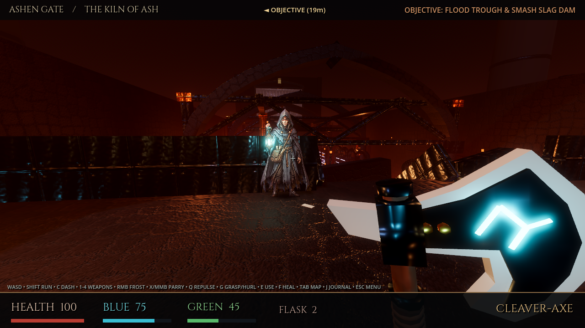 | 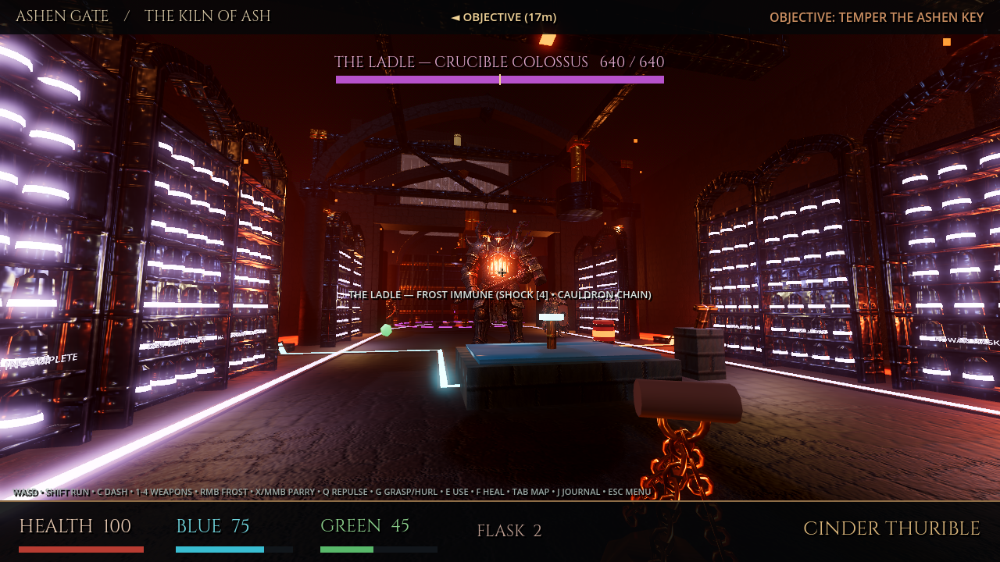 |

| The Great Ashen Gate Unsealed — The Hollow Beyond |
| :---: |
| 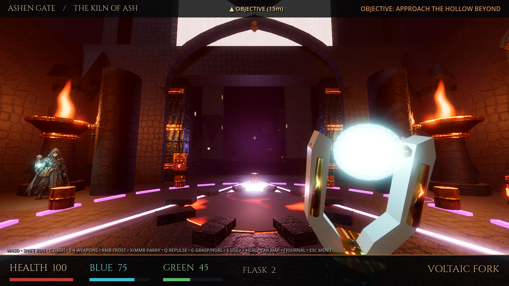 |

## Controls

| Input | Action |
| --- | --- |
| `WASD` / Mouse | Move / Look |
| `Shift` / `C` (`Alt`) / `Space` | Sprint / Aether Dash / Jump (coyote time + ledge mantle) |
| `1` / `2` / `3` / `4` | Runed Cleaver-Axe / Briar Arbalest / Cinder Thurible / Voltaic Tuning Fork |
| `LMB` | Attack / Fire / Hurl held object |
| `RMB` | Frost Bolt (10 Blue Mana) — freezes foes, water channels, spouts, and steam pipes |
| `MMB` / `X` | Timed Parry — negates blow, stuns attacker, restores +25 Blue Mana |
| `Q` | Telekinetic Repulse (15 Blue Mana) — wall-slams foes, reflects orbs, swings pendulum |
| `G` | Telekinetic Grasp — levitate urns/blocks/casks or **rip tower shields off Executioners** |
| `E` | Interact (NPCs, unpicking locks, levers, valves, alchemical fonts, inscriptions) |
| `F` | Alchemical Flask (+45 HP, refilled at Alchemical Fonts) |
| `Tab` / `J` | Automap / Story Journal |
| `F5` / `F9` | Quicksave / Quickload (plus automatic milestone checkpoints) |
| `R` | Reload latest checkpoint after death |
| `Escape` | Pause & Settings Menu (sensitivity, difficulty, Vulkan graphics toggles) |

## Verification Suites

All four headless Godot 4.7.2 regression suites cover campaign progression, physics/combat, narrative beats, and 3D geometry/collision integrity:

```bash
.tools/Godot_v4.7.2-stable_linux.x86_64 --headless --path . --script tests/smoke.gd
.tools/Godot_v4.7.2-stable_linux.x86_64 --headless --path . --script tests/physics_magic.gd
.tools/Godot_v4.7.2-stable_linux.x86_64 --headless --path . --script tests/story_beats.gd
.tools/Godot_v4.7.2-stable_linux.x86_64 --headless --path . --script tests/geometry_audit.gd
```
