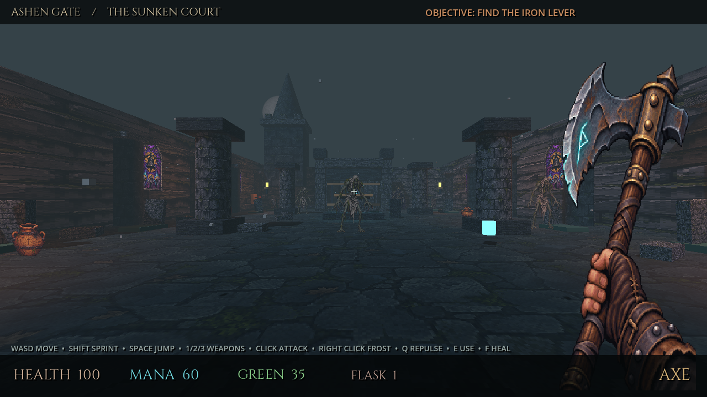

# Ashen Gate

A native Linux dark-fantasy FPS built in **Godot 4.7 (Forward+ Vulkan)** combining classic retro-FPS movement and 2.5D sprite combat with modern PBR lighting, volumetric fog, SSAO/SSIL/SSR, animated shaders, and tactile physics puzzles.



## Play

```bash
./run.sh
```

The launcher uses Godot 4.7.2 if installed, otherwise the bundled Linux runtime or a one-time download of the official Linux runtime.

## Premise & Campaign (Act I — 3 Interconnected Levels)

The kingdom of Vaelor sealed its dead behind the Ashen Gate, an iron-and-basalt citadel powered by resonant bells and alchemical frost. When the Bell Warden's chime fractured, the seal inverted—pulling the living in and trapping the dead in perpetual dusk.

1. **The Sunken Court**: Explore the South Gatehouse, flooded West Cistern (**Briar Arbalest** + secret alcove), East Catacombs (**Iron Lever** + lights-out ambush + shortcut), and solve the **Counterweight Portcullis** puzzle.
2. **The Bell Tower**: Traverse the 5-chamber Gothic spire—Clockwork Gallery (**Ward 1** gear jam), Pendulum Foundry (**Cinder Thurible** + **Ward 2** pendulum smash), North Choir Loft (**Ward 3** harmonic bell sequence), and face the **Bell Warden** in the open-sky Belfry Sanctum.
3. **The Kiln of Ash**: Freeze cascading aqueduct spouts into temporary ice bridges, smash the Smeltery slag dam with the ore-cart, forge the **Ashen Key** via Thermal Tempering, survive the Foundry Gauntlet using shootable **Slag Cauldrons**, and unseal the **Great Ashen Gate**.

## Controls

| Input | Action |
| --- | --- |
| `WASD` / Mouse | Move / Look |
| `Shift` / `Space` | Sprint (+35% speed, +6° FOV) / Jump (coyote time + ledge mantle) |
| `LMB` | Attack / Fire |
| `1` / `2` / `3` | Runed Cleaver-Axe / Briar Arbalest / Cinder Thurible |
| `RMB` | Frost Bolt (10 Blue Mana) — slows/freezes foes, forms 12s ice bridges, jams steam gears |
| `Q` | Telekinetic Repulse (15 Blue Mana) — slams foes into walls, reflects orbs, pushes puzzle props |
| `E` | Interact (levers, valves, alchemical fonts, portals, lore inscriptions) |
| `F` | Alchemical Flask (+45 HP, refilled at Alchemical Fonts) |
| `Tab` / `J` | Automap / Story Journal |
| `F5` / `F9` | Quicksave / Quickload |
| `Escape` | Release or capture cursor |
| `R` | Restart after death or completion |

## Development & Tests

Open `project.godot` in Godot 4.7.2. Run headless automated verification tests:

```bash
.tools/Godot_v4.7.2-stable_linux.x86_64 --headless --path . --script tests/smoke.gd
.tools/Godot_v4.7.2-stable_linux.x86_64 --headless --path . --script tests/physics_magic.gd
```

The Cinzel font is under the SIL Open Font License (`fonts/OFL-Cinzel.txt`).
